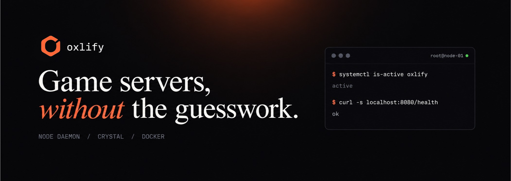

# oxlify

**A per-node game server daemon, written from scratch in Crystal.**

## What it is

oxlify is a per-node game server daemon written from scratch in Crystal. It is a drop-in
replacement for the panel's Node.js daemon: the same HTTP and WebSocket contract, the same
wings-style data layout, and the same expectations about how a panel talks to a node. Nothing is
shared with Pterodactyl or Wings.

It is the node daemon for **pyloxdactyl**, the only officially supported panel. Other open-source
panel projects and forks are not supported.

The daemon links only the Crystal standard library — no shards and no web framework — and talks to
Docker over `/var/run/docker.sock`.

## Features

- Server lifecycle with Wings-style semantics, and a create call that is safe to repeat
- Live console over WebSocket, buffered and throttled before it is fanned out
- Graceful stop, and a `starting` state driven by the egg's startup line
- File manager, backups and archive handling confined to a single server volume
- SFTP through a small libssh helper that `chroot`s every session
- Memory, CPU and disk limits, with disk accounting cached for fast panels
- Host reporting for total memory, CPU count and disk

## Supported operating systems

Any modern, 64-bit Linux distribution with `systemd` and a Docker Engine build works. These are
the distributions oxlify is developed and tested against:

| Distribution | Versions | Status |
| --- | --- | --- |
| Ubuntu LTS | 22.04, 24.04 | Tested |
| Ubuntu derivatives | Linux Mint 21/22, Pop!_OS, Zorin, elementary | Tested |
| Debian | 11 (Bullseye), 12 (Bookworm), 13 (Trixie) | Tested |
| Rocky Linux / AlmaLinux | 9 | Supported |
| Fedora | 39 and newer | Supported |
| Arch Linux / Manjaro | Rolling | Supported |
| openSUSE | Leap 15.5+ | Supported |

**Not supported**

- **Windows and macOS** — the daemon needs Docker's Unix socket and `chroot` for SFTP.
- **WSL2 as a node** — Docker networking and `chroot` confinement are not suitable for production
  game servers.
- **Rootless-only Docker** — unless you point the daemon at the rootless socket and accept that
  SFTP `chroot` needs root.

## Requirements

| | |
| --- | --- |
| Architecture | `x86_64`, or `arm64` when the images you run match the node |
| Docker Engine | 20.10 or newer; 24.0+ recommended, reachable at `/var/run/docker.sock` |
| Init system | `systemd` |
| `libssh` runtime | required by the optional `oxlify-sftp` helper |
| Privileges | root — needed for the Docker socket, volume ownership and SFTP `chroot` |
| Crystal (to build) | `>= 1.9` |

The daemon itself is tiny — a few megabytes of memory and almost no CPU. Size the node for the
game servers it will host rather than for oxlify.

## License

GPL-3.0. See [LICENSE](LICENSE).
